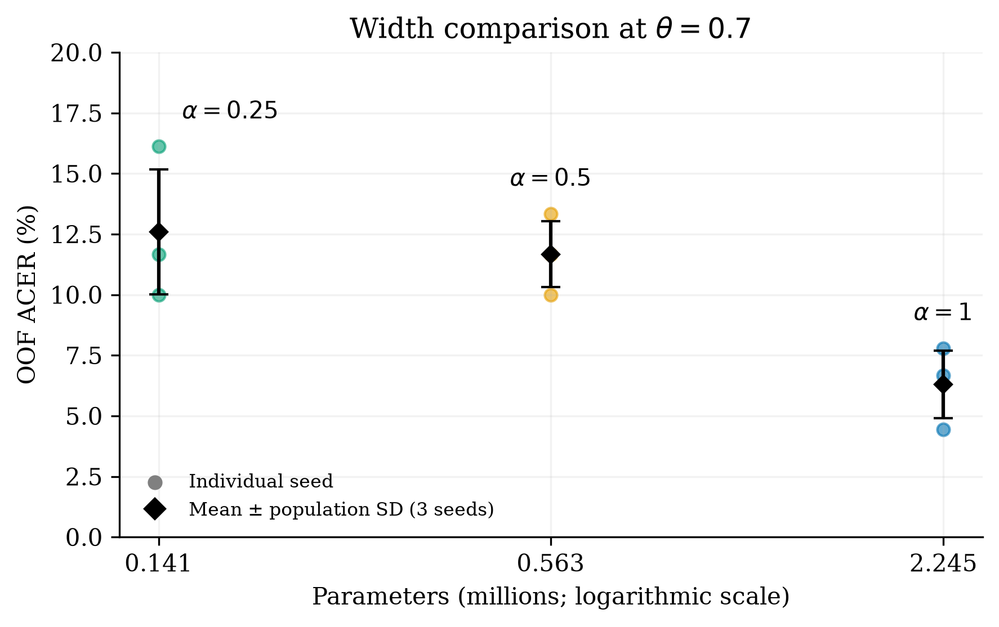
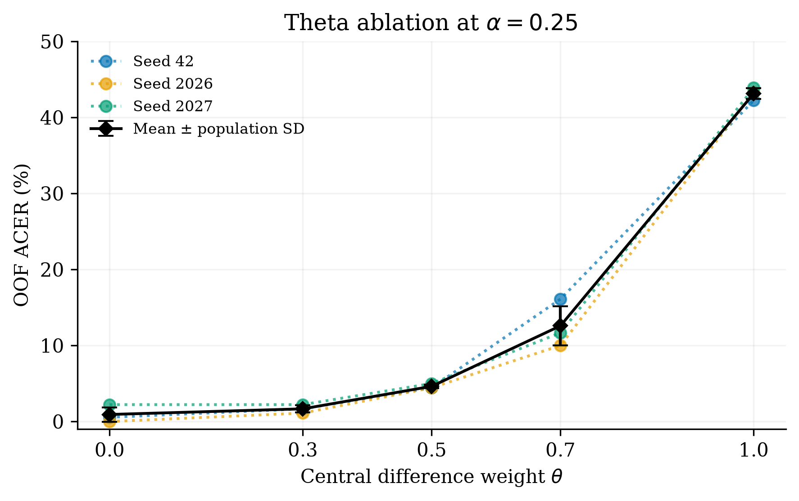
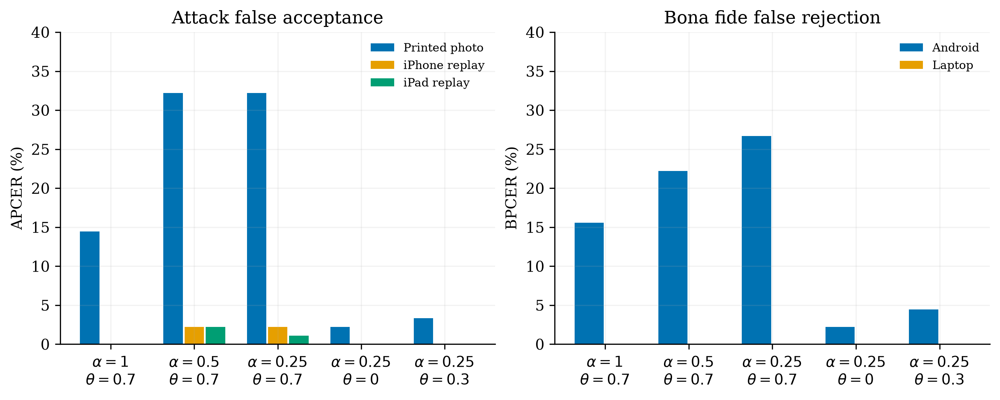

**Analysis of the labkc-comm3 experiment results — 5 November 2026**

The development results show a clear cost when CDCN becomes narrower at the fixed value θ = 0.7. However, the quarter-width network performs much better when θ = 0, which makes its convolutions ordinary convolutions. This result does not support the hypothesis that a positive central difference weight improves detection in this campaign.

The analysis also identifies a method discrepancy. Chapter 3 favors the compact model with lower ACER when both compact models remain on the Pareto frontier. Half width has lower mean ACER, but the theta campaign used quarter width. This decision needs an explicit explanation before the results become thesis claims.

These findings concern development validation data. The copied outputs contain no official test predictions or saved efficiency benchmarks. They cannot establish final test performance, measured speed, or a final deployment choice.

The source is [the local result snapshot](../outputs/labkc-comm3/). The research questions and method come from the current [Chapter 1](../../skripsi-document/chapters/bab1.tex), [Chapter 2](../../skripsi-document/chapters/bab2.tex), and [Chapter 3](../../skripsi-document/chapters/bab3.tex).

**The saved prediction files support a complete analysis of the two current validation matrices.**

| Campaign | Available validation runs | Role in this analysis |
| --- | ---: | --- |
| `small-width` | 45/45 | Three widths × five folds × three seeds, θ = 0.7 |
| `small-theta-a02` | 75/75 | Five theta values × five folds × three seeds, actual α = 0.25 |
| `main` | 60/60 | Earlier CDCN/CDCN++ and supervision comparison, reported separately below |
| `baseline` | 0 usable prediction sets | One training summary exists, but no video predictions support independent metric calculation |

The theta folder name ends in `a02`, but every resolved configuration in it specifies `width_multiplier: 0.25`. Configuration files determine the width used here.

The 120 current run records represent 105 distinct configuration/fold/seed combinations. The 15 quarter-width, θ = 0.7 combinations appear in both matrices. Their video predictions and recomputed metrics match exactly for every seed. These records provide a reproducibility check, rather than additional independent seed results.

All 120 current records use source revision `0c710262097574118c06fbe505a4b7f6236ce7cc`. Their recorded fold, frame, PRNet checkpoint, depth-target, and depth-generation hashes agree. Their controlled configuration fields also agree after removing the intended width, theta, fold, seed, and campaign identifiers.

For each current run, the audit checked 12 training subjects, three validation subjects, and 20 test subjects. The three subject sets do not overlap. Recorded video membership agrees with those subject lists. Each fold contains 24 validation videos: 18 attacks and six bona fide videos. Each video contains eight distinct evaluated frames. Saved video scores agree with the average frame scores.

Across five folds, each configuration and seed supplies 120 unique validation videos from the 15 development subjects. These comprise 90 attacks and 30 bona fide videos. The same development subjects appear again under different seeds, so three seeds do not create three independent datasets.

**The main tables follow Chapter 3's pooled out-of-fold threshold rule.** Out-of-fold (OOF) predictions combine the validation predictions from all five folds. Each video comes from a model that excluded its subject during training. One threshold then minimizes ACER over those 120 predictions for each configuration and seed. Accuracy and then the lower threshold break ties.

APCER is the percentage of attacks accepted as bona fide. BPCER is the percentage of bona fide videos rejected as attacks. ACER averages these two error rates. Lower values are better. F1 treats attack as the positive class. AUC measures score ranking, with higher values indicating better separation. F1 and AUC below use the 0–1 scale.

Reported ACER uncertainty is the population standard deviation across three seeds, as used by the repository's reporting code. It measures seed variation on this development split. It is not a confidence interval or a significance test. Other columns below show means. All per-seed values and metric standard deviations are available in the generated tables.

| Width α, fixed θ = 0.7 | ACER % ± SD | APCER % | BPCER % | AUC | F1 | Accuracy % |
| --- | ---: | ---: | ---: | ---: | ---: | ---: |
| 1.00 | 6.30 ± 1.39 | 4.81 | 7.78 | 0.9744 | 0.9625 | 94.44 |
| 0.50 | 11.67 ± 1.36 | 12.22 | 11.11 | 0.9227 | 0.9163 | 88.06 |
| 0.25 | 12.59 ± 2.58 | 11.85 | 13.33 | 0.9178 | 0.9154 | 87.78 |

Relative to full width, half width increases mean ACER by 5.37 percentage points. Quarter width increases it by 6.30 points. Thus, width reduction alone at θ = 0.7 does not preserve detection performance in these results.

The compact models differ by only 0.93 points in mean ACER. Half width performs better for seed 42, while their ACER values tie for seeds 2026 and 2027. Quarter width also shows more seed variation. These three seeds do not establish a statistically significant difference between the compact models.

| Width α | ACER %, seed 42 | ACER %, seed 2026 | ACER %, seed 2027 |
| --- | ---: | ---: | ---: |
| 1.00 | 6.67 | 4.44 | 7.78 |
| 0.50 | 13.33 | 10.00 | 11.67 |
| 0.25 | 16.11 | 10.00 | 11.67 |



The [vector width figure](figures/results-analysis-2026-11-05/width_vs_capacity.pdf) uses an architectural parameter count on its horizontal axis. It does not show measured latency.

**The completed theta campaign contradicts the expected benefit of positive θ at quarter width.**

| Theta, fixed α = 0.25 | ACER % ± SD | APCER % | BPCER % | AUC | F1 | Accuracy % |
| --- | ---: | ---: | ---: | ---: | ---: | ---: |
| 0.0 | 0.93 ± 0.94 | 0.74 | 1.11 | 0.9990 | 0.9944 | 99.17 |
| 0.3 | 1.67 ± 0.45 | 1.11 | 2.22 | 0.9984 | 0.9907 | 98.61 |
| 0.5 | 4.63 ± 0.26 | 4.81 | 4.44 | 0.9898 | 0.9678 | 95.28 |
| 0.7 | 12.59 ± 2.58 | 11.85 | 13.33 | 0.9178 | 0.9154 | 87.78 |
| 1.0 | 43.15 ± 0.69 | 30.74 | 55.56 | 0.5105 | 0.7196 | 63.06 |

At θ = 0, ACER equals 0.56%, 0.00%, and 2.22% for seeds 42, 2026, and 2027. These results contain respectively one, zero, and two classification errors. They do not show perfect OOF classification for every seed.

On the primary ACER metric, θ = 0 is best or tied against every positive theta value for each seed. Compared with θ = 0.7 at the same width, its mean ACER decreases by 11.67 points. Its mean also improves on the full-width θ = 0.7 baseline by 5.37 points. That second comparison changes both width and theta, so it cannot attribute the improvement to width reduction alone.

At θ = 1, AUC is approximately 0.51, and EER averages 48.89%. Therefore, the poor result includes weak class ranking, beyond a single poorly placed threshold. The saved scores do not establish its cause. Information suppression and optimization difficulty remain possible explanations, rather than demonstrated mechanisms.

The network at θ = 0 retains the CDCN topology and scaled channels, but uses ordinary convolutions. A thesis claim must state this clearly. The evidence supports ordinary convolution as the strongest tested quarter-width control on this development split. It does not establish that central difference is generally ineffective, or that θ = 0 is best at untested widths.



The [vector theta figure](figures/results-analysis-2026-11-05/theta_oof.pdf) shows each seed and the mean with population SD. Connecting lines only connect tested theta values.

**The width choice needs reconciliation with the method before a final model is declared.** A Pareto frontier contains configurations for which no alternative improves error without increasing computational requirements. With ACER and the derived parameter/MAC counts, both compact widths remain on that frontier. Half width has lower ACER, while quarter width requires less computation.

Chapter 3 then prioritizes lower ACER when both compact widths remain on the frontier. On the evidence currently available, this points to α = 0.5. The completed theta campaign instead fixes α = 0.25. The folder name and later success of θ = 0 do not establish a prior reason for that choice. Saved latency measurements are also absent, so the full intended efficiency comparison remains incomplete.

The defensible options are to document a genuine prior reason for selecting quarter width, or to complete theta experiments at the width selected by the stated rule. If the selection policy changes, the thesis must disclose the change and its timing. The current quarter-width theta campaign can still support an explicitly exploratory analysis.

**The available artifacts support architectural efficiency estimates, but no measured speed comparison.** The table below derives counts from the exact CDCN channel layout in [the model source](../src/cdcn_msu_mfsd/models.py). The MAC convention follows [the efficiency source](../src/cdcn_msu_mfsd/efficiency.py): one multiply-accumulate counts as one MAC, including the extra 1×1 difference convolution when θ is nonzero.

| α | θ | Trainable parameters | Parameter reduction versus baseline | Estimated convolution GMACs |
| --- | ---: | ---: | ---: | ---: |
| 1.00 | 0.7 | 2,245,016 | 0.00% | 52.597 |
| 0.50 | 0.7 | 562,636 | 74.94% | 13.181 |
| 0.25 | 0.7 | 141,350 | 93.70% | 3.311 |
| 0.25 | 0.0 | 141,350 | 93.70% | 2.980 |

Counts assume one RGB 256×256 input. They exclude batch normalization, activations, pooling, interpolation, kernel summation, and other operations outside the repository's convolution MAC convention. No forward pass or timing benchmark produced these numbers. At fixed quarter width, θ = 0 removes 10% of the estimated convolution MACs without changing parameter count.

The script also records raw model-state tensor payload estimates in `static_efficiency.csv`. These exclude serialization overhead. They are not measured serialized `state_dict` file sizes. The saved training checkpoints contain additional training state, so their file sizes cannot substitute for the deployment-size metric in Chapter 3.

The logged `gpu/max_memory_gib` field also cannot supply a clean architecture comparison. Its implementation reads the process peak of CUDA reserved memory without resetting the peak for each run. For identical quarter-width θ = 0.7 predictions, mean logged peaks differ between campaigns: approximately 4.59 GiB versus 1.03 GiB. These values reflect process history as well as the current run. They should not become claims about per-model inference memory.

**Printed attacks account for most false accepts at θ = 0.7.** All subgroup results retain the global OOF threshold for each seed. Each attack category contains 30 development videos per seed.

| Configuration | Printed-photo APCER % | iPhone-replay APCER % | iPad-replay APCER % |
| --- | ---: | ---: | ---: |
| α = 1.0, θ = 0.7 | 14.44 | 0.00 | 0.00 |
| α = 0.5, θ = 0.7 | 32.22 | 2.22 | 2.22 |
| α = 0.25, θ = 0.7 | 32.22 | 2.22 | 1.11 |
| α = 0.25, θ = 0.0 | 2.22 | 0.00 | 0.00 |
| α = 0.25, θ = 0.3 | 3.33 | 0.00 | 0.00 |

At full width, all 13 false-accept occurrences across the three seeds involve printed photos. At quarter width and θ = 0.7, 29 of 32 false-accept occurrences involve printed photos. Several printed videos from subjects 005, 006, 007, and 008 recur among compact-model errors. The generated `errors.csv` records exact video IDs and seeds for inspection.

At θ = 0.7, every bona fide rejection across the three tested widths comes from an Android recording. Android BPCER averages 15.56%, 22.22%, and 26.67% as width decreases. Laptop BPCER remains zero for these configurations. At quarter width and θ = 0, Android BPCER decreases to 2.22%. Each device contains only 15 bona fide development videos per seed, so these subgroup estimates have small denominators.

Android and laptop identify the capture device. iPhone and iPad in the attack categories identify the replay medium. These fields describe different parts of the acquisition process. The observed errors do not establish a causal explanation about image texture, lighting, or crop quality without inspection of the corresponding images.



The [vector subgroup figure](figures/results-analysis-2026-11-05/subgroup_errors.pdf) displays means across seeds. It does not pool repeated predictions into additional independent videos.

**Training behavior supports the performance observations, but depth loss and classification error remain different measurements.** All 120 current runs stop through the configured 30-epoch patience, before the 200-epoch cap. Saved best validation losses agree with the minima of the epoch histories.

At θ = 0.7, mean best validation depth loss is 0.04543 for full width, 0.04944 for half width, and 0.04808 for quarter width. Quarter width has slightly lower depth loss than half width, despite higher OOF ACER. Thus, lower map loss does not guarantee lower classification error. The best-checkpoint criterion remains validation depth loss, as Chapter 3 specifies.

For quarter width, mean best validation loss improves to 0.02453 at θ = 0 and worsens to 0.06799 at θ = 1. Mean training loss at those checkpoints is respectively 0.01352 and 0.06561. High theta therefore also fits the training objective poorly under the fixed training schedule. These numbers do not isolate the underlying cause.

The script converts saved zero-based best-epoch indices to one-based counts before calculating median refit lengths. For seeds 42, 2026, and 2027, full-width refit lengths are 37, 44, and 34 epochs. Quarter-width θ = 0 lengths are 49, 58, and 60 epochs. These are derived refit settings, not evidence that refitting already occurred.

**Fold-level dashboards and pooled OOF results answer different questions.** Saved fold thresholds optimize each fold separately. Chapter 3 instead requires one threshold after combining five folds for a seed. Their ACER summaries differ as follows.

| Configuration | Mean ACER using separate fold thresholds % | Mean ACER using pooled OOF thresholds % |
| --- | ---: | ---: |
| α = 1.0, θ = 0.7 | 4.44 | 6.30 |
| α = 0.5, θ = 0.7 | 9.81 | 11.67 |
| α = 0.25, θ = 0.7 | 10.19 | 12.59 |
| α = 0.25, θ = 0.0 | 0.00 | 0.93 |
| α = 0.25, θ = 0.3 | 0.19 | 1.67 |

Perfect fold-level separation at θ = 0 does not guarantee a perfect shared threshold across independently trained folds. Fold score scales can differ. Averaging the dashboard's fold ACER values would therefore misstate the method currently written in Chapter 3.

The W&B confusion fields use bona fide as the positive class, while F1 in the evaluation report uses attack as positive. This changes TP/FP/FN labels, but does not change the stored false-accept and false-reject counts. Chapter tables should use those explicit error names, or rebuild the confusion matrix with a declared positive class. The calculations here use the saved video labels and explicit error definitions.

OOF model predictions exclude each validation subject during training, but their labels still select the threshold and configuration. Consequently, these are development estimates rather than an untouched estimate of final generalization. One extra bona fide rejection changes ACER by 1.67 points. One extra accepted attack changes it by 0.56 points. This granularity matters when comparing near-zero results.

**The earlier main campaign provides additional context without replacing the current width experiment.** It uses seeds 2026, 2027, and 2028. The current matrices use 42, 2026, and 2027. Its older saved metric schema omits F1, which the analysis calculates from predictions.

| Earlier configuration, full width and θ = 0.7 | OOF ACER % ± SD |
| --- | ---: |
| CDCN, binary supervision | 0.93 ± 0.52 |
| CDCN, pseudo-depth supervision | 6.11 ± 1.36 |
| CDCN++, binary supervision | 0.56 ± 0.45 |
| CDCN++, pseudo-depth supervision | 7.41 ± 1.39 |

These results do not support a claim that pseudo-depth supervision outperformed binary supervision in the earlier campaign. They remain a separate comparison because architecture, supervision, and seed coverage differ from the present research questions. The current width comparison correctly retains pseudo-depth supervision for every width.

**The current evidence answers the research questions with the following limits.**

| Research question | Supported finding | Remaining limitation |
| --- | --- | --- |
| Width and detection | Narrower models increase OOF ACER at fixed θ = 0.7. | Official test performance is absent. |
| Width and efficiency | Parameter and convolution MAC counts decrease substantially. | Measured latency and serialized model-state sizes are absent. |
| Contribution of theta | At α = 0.25, θ = 0 gives the lowest mean OOF ACER. Positive theta does not improve the primary metric for any seed. | Quarter-width selection conflicts with the written decision rule. Final test evidence is absent. |

The computational part of the first hypothesis receives support, and its expected detection cost appears in the width experiment. The expected latency improvement remains untested in this snapshot. A final claim about the best performance/efficiency trade-off remains premature. The third hypothesis receives no support from the completed quarter-width campaign. This is a valid negative finding that the thesis should report directly.

The following evidence remains necessary for a complete thesis account:

1. Reconcile the width-selection decision and document the role of the existing quarter-width theta campaign.
2. Measure FP32, batch-one inference latency and serialized model-state size under the Chapter 3 conditions. Keep CPU and GPU results separate.
3. Freeze the chosen configurations, OOF thresholds, and refit epoch counts before the official test evaluation.
4. Report final refit/test results when available. The absence of test artifacts here establishes a snapshot gap, rather than proof about all past server activity.
5. Supply the manualisasi evidence promised in Chapter 3: explicit 5×5 input, 3×3 kernel, one traced output, θ = 0/0.7/1, and a numerical implementation comparison within 10⁻⁶. The source test for θ = 0 does not supply this complete worked example. No matching worksheet or comparison output accompanies this snapshot.

Chapter 3's manual-calculation paragraph also omits the input function in both component expressions. The terms need `x(p0 + pn)` and `x(p0)`, respectively. Chapter 2's CDC equation already uses these input values correctly. The worked example must multiply kernel weights by input values, rather than spatial coordinates.

**The calculations and figures are reproducible from the copied snapshot.** [The analysis script](../analysis/analyze_results.py) independently calculates the metric formulas in [the evaluation source](../src/cdcn_msu_mfsd/evaluation.py). All recomputed top-level fold metrics match their saved counterparts within 10⁻¹² across 180 usable runs. The pre-existing full-width, seed-42 OOF report also matches. The audit records source hashes, split consistency, controlled fields, and repeated-reference equality.

Generated local artifacts live in [results/labkc-comm3-analysis](../results/labkc-comm3-analysis/). They include `summary.csv/json`, `per_seed.csv/json`, `fold_metrics.csv`, `subgroups.csv`, `errors.csv`, `oof_predictions.csv`, `learning_curves.csv`, `static_efficiency.csv/json`, and `audit.json`. The copied data and these generated tables remain Git-ignored. This report, the scripts, and three PDF/PNG figure pairs preserve the reviewable findings in Git.

From the experiment repository root, regenerate the tables with:

```bash
rtk proxy python3 analysis/analyze_results.py
```

Regenerate the figures with [the plotting script](../analysis/plot_results.py):

```bash
rtk proxy uv run --no-project --with matplotlib python analysis/plot_results.py
```

The analysis requires the project's existing PyYAML dependency. The plotting command uses a separate temporary environment and does not change the project dependency files. Validation for this analysis consists of the complete artifact audit, Ruff checks on the two scripts, and visual inspection of all three rendered figures.
